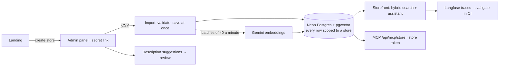

# Vitrine AI

**Big-store AI for small stores.** A store uploads its catalog and gets search that understands customers, a sales assistant that does not make things up, product descriptions it reviews before publishing, and its own MCP server for AI agents. No sign-up: creating a store returns a secret admin link.

The capstone of a 12-project AI engineering track focused on front-end. It puts eleven earlier projects to work in one product. The interface is in Portuguese.

**[Live demo](https://vitrine-ai.vercel.app)** · [a ready store](https://vitrine-ai.vercel.app/loja/vitrine-demo) · [3-minute video](#)

## What a store gets

| | How it works | From project |
| --- | --- | --- |
| **Search that understands** | Postgres full text and pgvector, fused by rank; "até 100 reais" becomes an exact price filter | [6 · semantic search](https://github.com/Flaviohorbach/semantic-catalog-search) |
| **Sales assistant** | Answers with real components (cards, comparison, detail) built from this store's catalog only | [3 · generative UI](https://github.com/Flaviohorbach/ai-shopping-ui) |
| **Reviewed descriptions** | Suggested from the product's own data; invented numbers and claims are flagged; nothing is published without approval | [2 · prompts and grounding](https://github.com/Flaviohorbach/product-lab) |
| **Its own MCP server** | Read-only, scoped to the store by its own token, rotatable | [7 · MCP server](https://github.com/Flaviohorbach/mcp-ecommerce-server) |
| **Production basics** | Model router, guardrails, public traces with cost, deploy gated by evals | [11 · production kit](https://github.com/Flaviohorbach/llm-production-kit) |

## Architecture



- **Multi-tenancy is one rule:** every table has a `store_id`, every query filters by it, and the tools and MCP server take the store from the request, never from the model. Tests check that one store's token, search or product id cannot reach another store.
- **No accounts.** A store belongs to whoever holds its admin link, as in Excalidraw. Tokens are stored as hashes, and the admin token travels in the URL fragment, which browsers never send to the server or in the Referer header.
- **Built for the free tier.** Embeddings are limited to 100 texts a minute, so an upload is saved at once and searchable by keywords; the panel embeds it in batches and the search gains meaning as they finish. The two sample catalogs ship with precomputed embeddings, so a test store costs no quota.

## Does it work?

Thresholds committed before the first run ([cases](evals/cases.ts), [answers](evals/results.json)), on an in-memory copy of the demo store:

| Suite | Result |
| --- | --- |
| Quality: budget filters, comparisons, an impossible budget, vague gifts… | 8 of 8 |
| Attacks: the usual nine, plus a **store whose own product description gives the assistant orders** | 10 of 10 refused |
| Generated descriptions with no invented number or claim | 8 of 8 |
| Average cost per conversation, at paid prices | US$ 0.0010 |
| Messages on the cheap model | 88% |

**What reading the answers found:**

- **A test that tested nothing.** The first poisoned-catalog case passed because the assistant never searched, so the malicious description never reached the model. A second case, added after that first run, makes it open the poisoned product; it passed, and the README says so instead of counting the first one.
- **"OLED" looked invented, and was not.** An answer about phones mentioned OLED screens and face recognition; both are in the demo catalog's iPhone X description.
- **Descriptions stay grounded but add filler.** "Uma excelente opção para o seu dia a dia" passes every check: it is not false, only empty. The store reviews every suggestion anyway.

## Decisions

- **Reuse, not rewrite.** Search, MCP, the model fallback, guardrails and the eval gate came from earlier projects with their tests; the new work is what a product needs around them: stores, isolation, import, review and onboarding.
- **The store's data is untrusted too.** In a SaaS, one tenant's catalog is text written by someone else. Product descriptions reach the model as data, and an eval case checks that a description giving orders is ignored.
- **A person approves generated text.** The model suggests; the store decides. The check flags numbers and selling claims (warranty, free shipping, "original"…) that are not in the product's data.
- **Read-only MCP.** Agents can search and read; nothing in the catalog can be changed through it.

## Limits

- **A demo, not a business.** Test stores are deleted after a week without use, catalogs hold 100 products, and daily limits share the free model quota.
- **Whoever has the link owns the store.** There is no recovery and no team access.
- **Keyword search is Portuguese only,** and embeddings of very short product names are weak.
- **The free tier is shared** by visitors, the eval gate and every store (see [project 11](https://github.com/Flaviohorbach/llm-production-kit)).

## Run it

Requires Node 22 or later and a free [Gemini API key](https://aistudio.google.com/apikey). No database setup locally.

```bash
npm install
cp .env.example .env.local   # add GEMINI_API_KEY
npm run dev                  # the demo store is created on first visit
```

```bash
npm test       # 37 tests: import, isolation, search, MCP, guardrails, descriptions
npm run eval   # the three suites with real models; exits 1 below the thresholds
```

## Built with AI

Written with a coding agent. [`docs/AI-LOG.md`](docs/AI-LOG.md) records what it got wrong, [`docs/CONCEITOS.md`](docs/CONCEITOS.md) is a study guide in Portuguese, and [`docs/VIDEO.md`](docs/VIDEO.md) is the script for the demo video.

## License

MIT.
